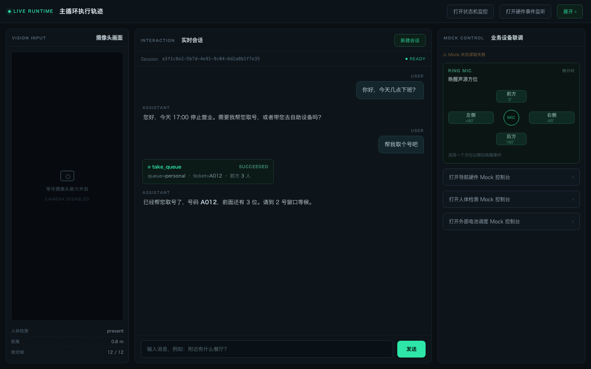

# 服务机器人 Agent 运行时 · 架构笔记

> 一台运行在线下服务场景里的机器人：轮式底盘、业务屏、数字人、环形麦阵。
> 一个 LLM Agent 站在中间，决定"现在该说什么、该调哪个能力、该把机器带到哪"。
>
> 这里记录的是它的骨架，以及为了撑住这套骨架做出的取舍。

📖 **在线文档**：https://liuyuelove.github.io/robot-agent-runtime-docs/

---

## ⚠️ 先读这个

这是**个人技术总结**，不是任何公司的产品文档，也不包含任何公司资产。

- ❌ 没有源代码、配置、内网地址、设备型号、协议细节
- ❌ 没有业务话术、业务规则、客户数据、真实对话
- ❌ 没有同事姓名、内部代号、公司名称
- ✅ 只有抽象的架构描述、设计判断和踩坑结论

文中出现的 `<llm-gateway>`、`192.0.2.10`（RFC 5737 文档保留地址）、`某厂商底盘` 等，全部是占位符。

---

## 这是什么系统

一套部署在**单台边缘机器**上的具身智能体运行时，要同时应付三类输入：

| 输入源 | 具体形态 |
|---|---|
| **人** | 走近、被唤醒、说话、被记住长相 |
| **设备** | 底盘位置、电量、业务屏状态、取号结果、充电桩握手 |
| **模型** | 一个会调工具、会跑偏、会说错话的 LLM |

然后把它们收敛成一条可预期的主线：**迎宾 → 对话 → 办业务 → 送别 → 回位 / 巡检 / 回充**。



> 示意图 · 按真实界面重绘，文案已全部替换为通用示例

难点不在"接一个大模型"，而在于 27 个外部设备与服务、18 个可被模型调用的能力、15 个机器人状态、十余条互相竞争的计时器，要在一个**没有运维介入的单机进程**里长期稳定地跑。

---

## 规模

| 项 | 数量 |
|---|---|
| 生产代码 | 约 7.8 万行 Python（586 个文件） |
| 测试代码 | 约 6.4 万行（151 个文件） |
| 设计文档 | 105 篇 Markdown |
| 公共 Adapter | 27 个（Hardware / Integration / Engine 三类） |
| 注册 Tool | 18 个（整套版本化切换） |
| 机器人状态 | 15 个（7 组 × 移动/驻停 + 急停） |
| 状态矩阵 | 转移 15×15 · 事件转发 15×18 |
| 架构守护测试 | 21 条（纯 AST 静态检查） |
| 团队 | 12 人 · 约 2.5 个月 · 897 次提交 |

---

## 目录

| 章节 | 讲什么 |
|---|---|
| [术语表](00-glossary.html) | **64 个词，每条都说清"不是什么"**；最容易混的十二组；译名对照；如果你熟悉别的架构 |
| [系统全景](01-overview.html) | 一次交互经过的七个边界；谁持有谁；为什么是单机部署 |
| [端到端时序](02-timeline.html) | **从声波到播报的九跳**、T0–T12 时间轴、三条打断路径、可测的延迟锚点、每一跳挂了会怎样 |
| [分层与边界](03-architecture.html) | 九层职责、依赖方向、四条硬规则、为什么禁止 Dispatcher |
| [Adapter 体系](04-adapters.html) | 三类判定、Real/Mock 合同一致、生命周期与 facade、Engine 六项门槛 |
| [Tool 体系](05-tools.html) | 代码注册作为唯一事实源、Schema 自动推导、工具集版本化 |
| [事件驱动](06-events.html) | 事实总线 vs 命令总线、不可变事件、明确不承诺的边界 |
| [会话生命周期](07-session.html) | 单活跃会话、人脸驱动的切换、**三类倒计时与六个暂停源**、双份历史 |
| [机器人状态机](08-robot-state.html) | **15 个状态**、转移矩阵、事件转发矩阵、能力准入、reaction、回充与急停 |
| [上下文压缩](09-compression.html) | 预算模型、有界批次、CAS 提交、"办过"与"办成了"的分离 |
| [提示词工程](10-prompt.html) | **prompt 作为代码**：按启用工具拼装、七版共存、两套相反的版本策略、改完怎么验证 |
| [配置体系](11-config.html) | 三级合并、启动期类型化、不可变的代价 |
| [可观测性](12-observability.html) | 单行 JSON 日志、按 Run 分解耗时、内容开关 ≠ 脱敏 |
| [测试策略](13-testing.html) | 21 个架构守护测试：把"不许这么写"变成会红的 CI |
| [AI 协作开发](14-ai-workflow.html) | 用唯一准则目录 + 架构测试约束人和 AI |
| [复盘与取舍](15-retrospective.html) | **从原型到运行时的一次重写**、两个具体案例、哪些判断事后被证伪 |

---

## 为什么只放文档，不放代码

代码是公司的。但**设计判断是可以带走的**。

这个项目里真正有价值的东西不是某段实现，而是这些问题的答案：

- 为什么系统里**故意没有** Dispatcher？
- 为什么 Hardware Adapter 不许调用另一个 Adapter？
- 为什么"在进程内运行"不足以让一个组件变成 Engine？
- 为什么事件总线明确**不承诺**顺序和幂等？
- 为什么把"不许这么写"写成测试，而不是写成文档？

这些答案换个项目依然成立，也不会泄露任何业务信息。

---

## 我的角色

> 这是 12 人团队的共建项目，**不是个人作品**。这份笔记记录整个系统的设计，个人贡献单列如下。

| 项 | 内容 |
|---|---|
| 角色 | 实习工程师（2026.06 – 2026.09，约 3.5 个月） |
| 我主导的模块 | 数字人 Integration Adapter（0→1）、定时移动迎宾、迎宾点归位判定、巡检结果链路、工具路由测评体系 |
| 我参与的部分 | 迎宾与状态机联调、ASR / TTS 生命周期、不活跃看门狗、下屏链路、充电状态显示、附近地点搜索 |
| 可验证产出 | 运行时主仓 52 次非 merge 提交；数字人 Adapter 约 35 个文件 / 2700 行，含 Real/Mock、测试与模块文档 |

同期还从 0 到 1 做过两个配套前端（不在本笔记范围内）：一个排队叫号大屏（多窗口并行、TTS 播报、暂停恢复、毫秒级链路日志），一个巡检结果面板（轮询、安全评分、异常图片预览）。合计 48 次非 merge 提交。

> 以上数字来自内部仓库的提交记录，只统计本人署名提交；内部仓库不公开，因此无法给出可点击的链接。

---

## 本地预览

纯静态页面，没有构建步骤：

```bash
python3 -m http.server 8000
# 打开 http://127.0.0.1:8000
```

部署到 GitHub Pages：仓库 Settings → Pages → Source 选 `main` 分支根目录即可。

---

## License

文档内容采用 [CC BY-NC 4.0](https://creativecommons.org/licenses/by-nc/4.0/) 许可，全文见 [LICENSE](LICENSE)。

可以转载、改编，但需**署名**且**不得用于商业用途**。Copyright © 2026 刘越。
